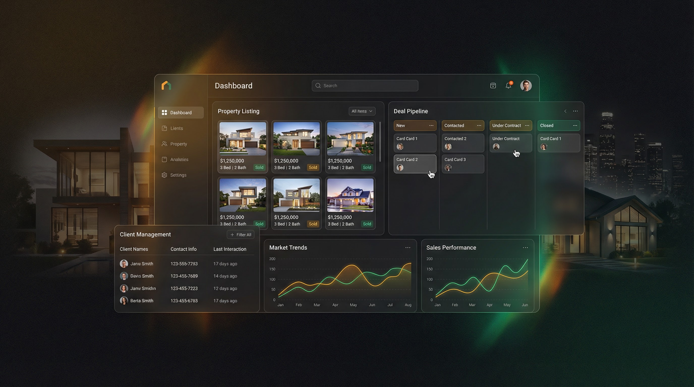

<div align="center">


# Haven Estate Suite

### The CRM Real Estate Agents Actually Want to Use

**MLS-style property records, deal pipeline, client management, and market analytics, all in one dashboard. Built for agents who close.**

[](LICENSE)
[](https://www.typescriptlang.org/)
[](https://react.dev/)
[](https://vitejs.dev/)
[](https://supabase.com)
[](https://ui.shadcn.com)

[Features](#features) · [Quick Start](#-quick-start) · [Architecture](#-project-structure) · [Tech Stack](#-technology-stack) · [Docs](#-documentation)

---



</div>

---

## Why this exists

**What it does.** Haven Estate Suite is a React, TypeScript, and Supabase CRM for residential real estate agents. It stores MLS-style listing records (MLS ID, status, listing date, days on market, agent), contacts and interaction history, a kanban deal pipeline, an activity timeline, and an analytics dashboard with report export. Listings live in a Supabase Postgres table with row-level security; the repository does not contain a live MLS feed connector (RESO Web API or RETS), so listing data is entered or imported by the operator.

**Who it serves.** Solo agents and small brokerages who have outgrown a spreadsheet but do not want a seat-priced enterprise CRM: one person or a small team tracking listings, buyers, and deals from a browser, with data isolated per user by database policy.

**Why Alex built it.** The repository's own problem statement, added in the branding pass (commit `becb367`, 2026-02-18, "feat: state-of-the-art README, cover art, icon, and branding"), records the motivation: real estate CRMs are either expensive enterprise tools or spreadsheets that fall apart at 50 contacts, and agents need a modern, fast, affordable platform without the learning curve. The project started as a Lovable-generated build on 2025-06-18 (first commit `53d074a`, "Use tech stack vite_react_shadcn_ts"; `b446082`, "Implement HavenCRM project plan"), was rebranded CozyMLS the same day (`5fadfa8`), and was hardened in October 2026 through PRs #1 to #5 (dependency and Tailwind migration, workflow token permissions, CodeQL reporting, validation commands).

**Real-world use case (2025-2026 evidence).** **Proposed use case.** A small brokerage needs every listing's status and dates in one place because the rules for when a listing may be marketed changed in 2025. NAR's "Multiple Listing Options for Sellers" policy (effective 2025-03-25, implementation deadline 2025-09-30) created delayed-marketing exempt listings that are filed with the MLS but held back from IDX and syndication for a local period[^1]. Zillow's Listing Access Standards, enforced from 2025-06-30, exclude any publicly marketed listing not entered into the MLS within one business day[^2], and a federal judge declined to block that policy in February 2026[^3]. An agent using this CRM would record each property's `status` (active, pending, sold, off-market), `listingDate`, and `daysOnMarket`, and use the activity timeline to log when marketing started, so the office can show its compliance window per listing. The repository has unit tests for the UI and Supabase migrations for the schema, but no evidence of use by a brokerage, so this remains proposed.

## Features

- **Property Management**, MLS-style listing records (MLS ID, status, listing date, days on market) with search, filtering, and property details
- **Client Management**, Track contacts, leads, and client relationships with full interaction history
- **Deal Pipeline**, Visual kanban board to manage deals through customizable stages
- **Activity Timeline**, Complete history of every interaction, showing, and event
- **Analytics Dashboard**, Real-time market insights, sales performance, and trend visualization
- **Report Generation**, Custom reports with data visualizations and export
- **Dark Mode**, Beautiful dark theme with seamless toggle
- **Responsive Design**, Desktop, tablet, and mobile with touch optimization
- **Real-Time Updates**, Live data synchronization across devices via Supabase
- **Row-Level Security**, Database-level security policies protecting every record
- **CI/CD Pipeline**, Automated testing, linting, and deployment via GitHub Actions

## 🚀 Quick Start

### Prerequisites

- Node.js 22.13+ ([install with nvm](https://github.com/nvm-sh/nvm))
- npm 11 package manager (the committed package-lock.json is authoritative)

### Installation

```bash
# Clone the repository
git clone https://github.com/Alexi5000/cozymls1.git
cd cozymls1

# Install dependencies
npm install

# Start development server
npm run dev
```

The application will be available at `http://localhost:8080`

For detailed setup instructions, see [docs/development/SETUP.md](docs/development/SETUP.md)

## 📁 Project Structure

This project follows the **Feature-Sliced Design** (FSD) architecture pattern:

```
src/
├── app/              # Application initialization and providers
├── pages/            # Route-level pages
├── widgets/          # Complex UI sections (Header, Sidebar, etc.)
├── entities/         # Business entities (Property, Contact, Deal)
├── shared/           # Shared utilities, hooks, and components
│   ├── ui/           # Reusable UI components (Button, Card, etc.)
│   ├── hooks/        # Custom React hooks
│   ├── lib/          # Utility functions
│   └── types/        # TypeScript type definitions
└── integrations/     # External service integrations (Supabase)
```

Learn more about our architecture in [docs/architecture/ARCHITECTURE.md](docs/architecture/ARCHITECTURE.md)

## 🛠️ Technology Stack

### Frontend
- **React 18.3** - UI library with hooks and modern patterns
- **TypeScript 5.9** - Type-safe JavaScript
- **Vite 7** - Fast build tool and dev server
- **Tailwind CSS 4** - Utility-first CSS framework
- **shadcn/ui** - High-quality component library
- **Radix UI** - Accessible component primitives
- **React Router v6** - Client-side routing
- **TanStack React Query** - Data fetching and caching
- **Recharts** - Data visualization library
- **Lucide React** - Icon library

### Backend
- **Lovable Cloud** - Integrated backend platform
- **PostgreSQL** - Relational database
- **Row Level Security** - Database-level security policies
- **Real-time Subscriptions** - Live data updates
- **Edge Functions** - Serverless backend logic

### Development Tools
- **ESLint** - Code linting
- **Prettier** - Code formatting
- **Vitest** - Fast unit test framework
- **Testing Library** - React component testing
- **GitHub Actions** - CI/CD automation
- **Conventional Commits** - Standardized commit messages

## 📚 Documentation

- [Architecture Overview](docs/architecture/ARCHITECTURE.md)
- [Database Schema](docs/architecture/DATABASE_SCHEMA.md)
- [Feature-Sliced Design](docs/architecture/FEATURE_SLICED_DESIGN.md)
- [Development Setup](docs/development/SETUP.md)
- [Coding Standards](docs/development/CODING_STANDARDS.md)
- [Testing Guidelines](docs/development/TESTING.md)
- [Deployment Guide](docs/deployment/DEPLOYMENT.md)
- [CI/CD Documentation](docs/deployment/CICD.md)

## 🤝 Contributing

We welcome contributions! Please read our [Contributing Guidelines](CONTRIBUTING.md) before submitting pull requests.

### Development Workflow

1. Fork the repository
2. Create a feature branch (`git checkout -b feature/amazing-feature`)
3. Commit your changes (`git commit -m 'feat: add amazing feature'`)
4. Push to the branch (`git push origin feature/amazing-feature`)
5. Open a Pull Request

See [CONTRIBUTING.md](CONTRIBUTING.md) for detailed guidelines.

## 📋 Available Scripts

```bash
# Development
npm run dev              # Start development server
npm run build            # Build for production
npm run preview          # Preview production build

# Testing
npm test                 # Run unit tests
npm run test:coverage    # Generate coverage report

# Code Quality
npm run lint             # Run ESLint
npm run lint -- --fix    # Apply ESLint fixes
npm run typecheck        # Run TypeScript compiler check
npm run validate         # Lint, types, tests, and production build

# CI/CD (automated)
npm run build:dev        # Build for development environment
```

## 🚢 Deployment

Haven Estate Suite can be deployed via:

1. **Lovable Platform** (Recommended)
   - One-click deployment
   - Automatic HTTPS
   - Custom domain support
   - See [Deployment Guide](docs/deployment/DEPLOYMENT.md)

2. **Self-Hosted**
   - Build: `npm run build`
   - Deploy `dist/` folder to any static hosting
   - Configure environment variables

## 🔒 Security

We take security seriously. Please read our [Security Policy](SECURITY.md) for:
- Reporting vulnerabilities
- Security best practices
- RLS policy guidelines
- Authentication security

Dependency and code-scanning status as of 2026-10-21: 0 open Dependabot alerts and 0 open critical or high code-scanning alerts. CodeQL's security-and-quality suite reports 16 open low-severity quality findings (unused local variables and superfluous observer arguments); they are not security issues and have not been suppressed. The `Security Scan` workflow (dependency audit plus a supplementary CodeQL job) runs on push and pull request, and GitHub's CodeQL default setup also scans the repository.

## 📄 License

This project is licensed under the MIT License - see the [LICENSE](LICENSE) file for details.

## 🙏 Acknowledgments

- Built with [Lovable](https://lovable.dev)
- UI components from [shadcn/ui](https://ui.shadcn.com)
- Icons by [Lucide](https://lucide.dev)
- Design system inspired by modern real estate platforms

## 📞 Support

- **Documentation**: [docs/](docs/)
- **Issues**: [GitHub Issues](https://github.com/Alexi5000/cozymls1/issues)
- **Security**: [SECURITY.md](SECURITY.md)

---

<div align="center">

**Built by [Alex Cinovoj](https://github.com/Alexi5000), Founder & CTO of TechTide AI**

*Close more deals. Manage less chaos.*

</div>

[^1]: National Association of REALTORS, "NAR Introduces New MLS Policy to Expand Choice for Consumers", press release, 2025-03-25. https://www.nar.realtor/press-releases/nar-introduces-new-mls-policy-to-expand-choice-for-consumers
[^2]: HousingWire, "Zillow will begin banning noncompliant listings on June 30", 2025-05-20. https://www.housingwire.com/articles/zillow-ban-noncompliant-listings-june-30-clear-cooperation-office-exclusives
[^3]: National Association of REALTORS, "Judge Rejects Compass's Request to Block Zillow's Private Listing Rule", 2026-02-06. https://www.nar.realtor/news/real-estate-news/law-and-ethics/judge-rejects-compasss-request-to-block-zillows-private-listing-rule
